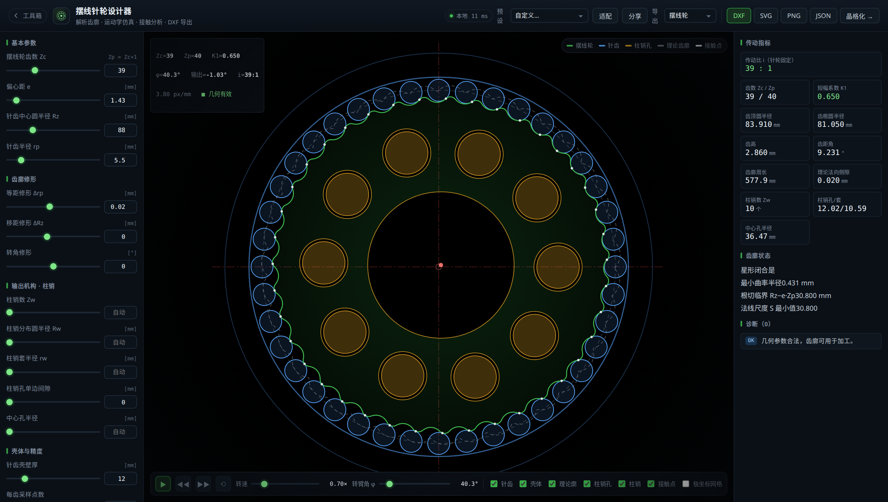
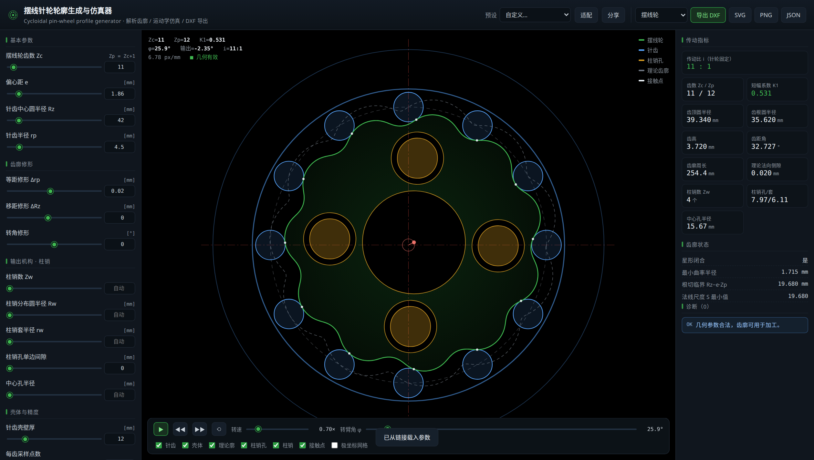
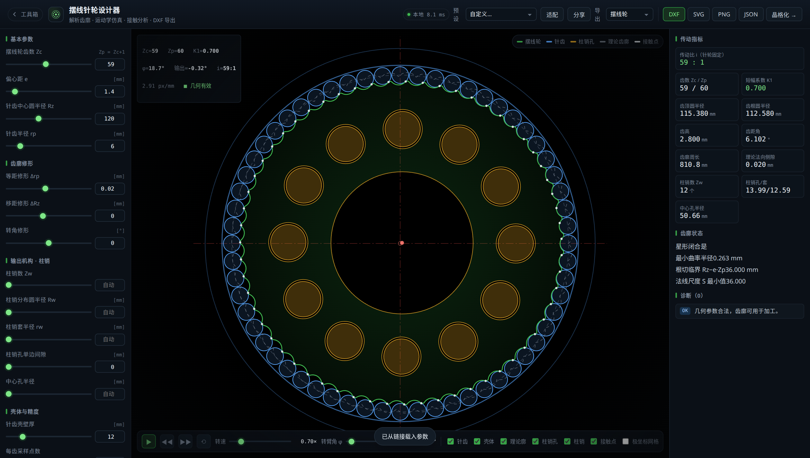

# echo-cad-toolbox

**摆线针轮设计器 + 晶格化工作台** —— 一个可部署在 Docker 中的 Web 工具箱。

**三个页面，两个工具，各自独立**（共用的只有设计令牌 `base.css` 与 three.js）：

| 页面 | 路径 | 做什么 |
| --- | --- | --- |
| 工具箱首页 | `/` | 启动台：两张卡片进入两个工具，显示服务状态与版本 |
| **摆线针轮设计器** | `/cycloid` | 交互式生成摆线针轮（RV / 摆线针轮减速器）齿廓、实时运动学仿真、啮合接触分析，导出**毫米级 DXF 图纸** |
| **晶格化工作台** | `/lattice` | 把 STL / STEP 实体转成**晶格结构**（gyroid / Schwarz P / Diamond 等 TPMS 与 BCC / FCC / Octet 桁架），**浏览器 GPU 实时生成**并导出 STL / 3MF / OBJ / PLY |

两个工具在**计算上互不依赖**：删掉 `app/static/cycloid/` 晶格化照常用，反之亦然；
两者只在"参数交接"上打通 —— 设计器顶栏的「晶格化 →」把齿廓参数带过去，工作台据此生成
3D 轮盘（齿廓拉伸 + 柱销孔 + 中心孔）再做减重晶格，不需要中间导出建模。

### 三种算力分配

| 环节 | 在哪算 | 为什么 |
| --- | --- | --- |
| 齿廓 / 运动学 / 接触分析 | **浏览器**（`cycloid/analysis.js`，与服务端逐字段一致） | 拖动滑块零延迟、零请求；实测 1~10 ms（服务端同参数 5~45 ms + 网络往返） |
| 文件格式解析 | STL 在**浏览器**；STEP / IGES 走服务端 | B-rep 必须用 OCCT，浏览器解不了；STL 只是三角面片，浏览器直接读 |
| 体素化（网格 → 距离场） | **浏览器**（Web Worker + 精确欧氏距离变换） | 吃客户机内存，不再被服务端容器钳住；实测 ⌀167 盘 res 320 只要 **0.8 s**（服务端 9 s / 460 MB） |
| 晶格场 × 等值面提取 | **浏览器 GPU**（WebGPU 计算着色器） | 每次调参都要重算；实测 160³ 体素 **~100 ms**（服务端同参数 1~3 s） |

**整条链路都在客户机上跑**，服务端只做两件事：把 STEP 转成三角网格、以及在浏览器
没有 WebGPU / 算不动时兜底。分辨率上限从「服务端容器内存 → 128」变成「你的显卡显存
→ 400」，这也是薄壁零件能画出来而不是碎成尖刺的前提。

> 没有 WebGPU 的浏览器会自动回退到服务端生成（老路径完整保留），界面上可以手动切换引擎。



| 紧凑型 11/12（i=11:1） | 大速比 59/60（i=59:1，齿高更小） |
| --- | --- |
|  |  |

```
┌────────────┬──────────────────────────────────┬────────────┐
│  参数面板   │        交互式 2D 视图             │  指标 / 诊断 │
│  基本参数   │  摆线轮 + 针轮 + 柱销 + 接触点     │  传动比     │
│  齿廓修形   │  滚轮缩放 / 拖拽平移 / 播放动画    │  齿顶齿根   │
│  输出机构   │                                  │  告警       │
└────────────┴──────────────────────────────────┴────────────┘
```

---

## 1. 快速开始

### 方式 A：Docker（推荐）

```bash
docker compose up -d --build
# 打开 http://localhost:8080
```

或直接使用镜像：

```bash
docker build -t echo-cad-toolbox:1.0.0 .
docker run -d -p 8080:8080 --name cad-toolbox echo-cad-toolbox:1.0.0
```

国内网络构建较慢 / 拉不到官方镜像时，可同时指定三个加速源（PyPI、基础镜像、Debian 软件源）：

```bash
PIP_INDEX_URL=https://mirrors.cloud.tencent.com/pypi/simple \
PYTHON_IMAGE=docker.m.daocloud.io/library/python:3.12-slim \
APT_MIRROR=mirrors.cloud.tencent.com \
docker compose up -d --build
```

> `APT_MIRROR` 是给晶格化准备的：`libgmsh.so` 需要 OpenGL / X11 运行库，其中 mesa 会拖入
> `libllvm19`（26 MB）。直连 `deb.debian.org` 在国内机器上会卡十几分钟甚至超时，
> 换镜像源后 apt 阶段从「卡死」变成几秒。

默认映射端口 `8080`，可用 `PORT=8090 docker compose up -d` 更换。

> 若宿主机 8080 已被占用，直接换端口即可（容器内始终是 8080）：
> `PORT=18080 docker compose up -d`，或
> `docker run -d --restart unless-stopped -p 18080:8080 --name echo-cad-toolbox echo-cad-toolbox:1.0.0`

### 服务器部署（纯 docker 一键脚本）

没有 `docker compose` 插件的主机（例如云服务器）用 `tools/deploy.sh`，它在上面 `docker run`
的基础上额外做了「同步源码 → 构建 → 替换容器 → 等健康检查 → 打印可访问地址」：

```bash
git clone --depth 1 https://github.com/EchoLab-Auto/echo-cad-toolbox.git /opt/echo-cad-toolbox
cd /opt/echo-cad-toolbox

# 指定端口（例：2228），三个源都走云厂商内网镜像
PIP_INDEX_URL=https://mirrors.cloud.tencent.com/pypi/simple \
PYTHON_IMAGE=docker.m.daocloud.io/library/python:3.12-slim \
APT_MIRROR=mirrors.cloud.tencent.com \
./tools/deploy.sh 2228

# 之后更新版本只需（PULL=1 先 git 同步到 origin/main）
PULL=1 PIP_INDEX_URL=... ./tools/deploy.sh 2228
```

> **构建加速的坑**：`PIP_INDEX_URL` 在 Dockerfile 里是 `ARG`，只能通过 `--build-arg`
> 传入。只写 `PIP_INDEX_URL=xxx docker build ...`（环境变量）**不会生效**，pip 仍走
> `pypi.org`，在国内主机上会卡在几 MB 的 wheel 上十几分钟。脚本已处理好这一点。

### 方式 B：本地运行

```bash
python3 -m venv .venv && source .venv/bin/activate
pip install -r requirements.txt
uvicorn app.main:app --host 0.0.0.0 --port 8080
```

访问 <http://localhost:8080>（工具箱首页）→ 摆线针轮设计器 <http://localhost:8080/cycloid>、
晶格化工作台 <http://localhost:8080/lattice>；API 文档在 <http://localhost:8080/docs>
（晶格化接口在 `/api/lattice/*`）。

> 晶格化需要 `gmsh` 的 OCC 内核做 STEP 离散，`libgmsh.so` 在动态链接阶段依赖
> OpenGL / X11 / freetype。Linux 桌面版一般已具备；无桌面的服务器需要装：
> `apt install libgl1 libglu1-mesa libx11-6 libxft2 libfontconfig1`（Dockerfile 里已处理）。

### 已部署实例

| 位置 | 地址 | 说明 |
| --- | --- | --- |
| cloud-server-2（腾讯云，广州） | <http://114.132.241.46:2228/> · <https://114.132.241.46:2228/> | 公网可达，同一个端口同时服务 http/https，`restart=unless-stopped`，内存上限 1.2 GiB（机器总内存仅 2 GB），跑 1.2.0 |
| cloud-server-2（子域名入口） | `http://cad.<你的域名>:2229/` | 域名前缀分流由 **echo-server-core** 的进程内插件 `esc.edge-router` 提供（见该仓 `docs/EDGE-ROUTER.md`）；本仓不再包含该反代 |
| 4090 工作站（内网） | <http://192.168.31.35:18080/> | 局域网可达，见下节 |

> **公网请用 `https://` 打开**：WebGPU 只在**安全上下文**里暴露 `navigator.gpu`，
> 而 `http://公网IP` 不是安全上下文 —— 用 http 打开时浏览器根本不提供这个 API，
> 工作台会回退到服务端生成（角标显示「服务器计算」，功能完整但慢一到两个数量级）。
>
> 同一个模型实测对比（cloud-server-2）：
>
> | 入口 | 角标 | 面数 | 耗时 |
> | --- | --- | --- | --- |
> | `http://…:2228` | 服务器计算 | 564,938 | 6.68 s |
> | `https://…:2228` | GPU · nvidia lovelace | 805,576 | **0.26 s** |
>
> 这不是程序缺陷，是 Web 平台规范。想让任何入口都能用 GPU，见下一节。

### 给入口配 HTTPS（公网也能用 GPU）

WebGPU 的 `navigator.gpu` 是 `[SecureContext]` 接口，而**安全上下文只看 URL scheme，
不看端口号** —— 所以不需要 443、不需要备案、不需要新开安全组端口，在已经在用的那个
端口上加一层 TLS 就够了：

```bash
TLS=1 PULL=1 PIP_INDEX_URL=https://mirrors.cloud.tencent.com/pypi/simple \
  ./tools/deploy.sh 2228
```

脚本会做三件事：把后端改绑 `127.0.0.1:18080`（公网不再直连）、起一个 `nginx` 前置
监听 `:2228`、按需签一张证书。前置用 `ssl_preread` 看首字节分流：

| 首字节 | 去向 |
| --- | --- |
| TLS ClientHello | 本机 https server 终止 TLS，再转后端（会补 `X-Forwarded-Proto`） |
| `GET` / `POST` … | 原样透传给后端 |

因此**同一个端口的 `http://` 和 `https://` 都继续可用**，老链接不会失效。

两个容器因此是**前置门房 + 后端本体**的关系：`echo-cad-toolbox-tls`（`nginx:alpine`，
host 网络，独占对外的 `:2228`）→ `echo-cad-toolbox`（应用本体，只发布在
`127.0.0.1:18080`，公网直连打不通）。后端不知道前置的存在，拆掉前置它照常跑，
只是不再有 https。

#### 证书是怎么来的

`/etc/ssl/cad/` 下是两段式签发的（mkcert 的路子）：

| 文件 | 作用 |
| --- | --- |
| `ca.pem` / `ca.key` | 本地根证书（`CA:TRUE`，10 年）—— **装到客户端就全绿** |
| `leaf.pem` / `privkey.pem` | 服务端证书（825 天），由上面的 CA 签发 |
| `fullchain.pem` | `leaf + ca`，nginx 实际加载的文件 |

叶子证书的 SAN 自动包含：公网 IP、本机所有网卡地址、`127.0.0.1`、`localhost`，
外加 `CERT_HOSTS` 里给的域名。换 IP 只需 `./tools/tls.sh renew`，客户端装过的
`ca.pem` 不用换。

> **为什么不是单张自签证书**：单张自签叶子（`CA:FALSE`）装进系统信任库会被拒
> —— Chrome 报 `certificate is not a CA`。要「彻底没有警告」就必须有 `CA:TRUE`
> 的根证书，所以分两段签。

#### 客户端要做什么

| 做法 | 效果 | 适合 |
| --- | --- | --- |
| 什么都不做，首次访问点『高级 → 继续前往』 | 地址栏标「不安全」，但 **WebGPU 正常工作**（安全上下文判定只看 scheme） | 自己临时看效果 |
| 装 `ca.pem` 进信任库 | 全绿锁，无任何警告 | 团队日常使用 |
| 换公共 CA 签发的证书（见下） | 全绿锁，无需在客户端装任何东西 | 对外交付 |

从服务器取根证书（`-showcerts` 才会输出完整链，第 1 张是叶子、第 2 张才是 CA）：

```bash
openssl s_client -showcerts -connect <host>:2228 </dev/null 2>/dev/null \
  | awk '/BEGIN CERTIFICATE/{n++} n==2' > cad-ca.pem
```

装到系统信任库：

```bash
# Ubuntu / Debian
sudo cp cad-ca.pem /usr/local/share/ca-certificates/cad-toolbox.crt && sudo update-ca-certificates
# macOS
sudo security add-trusted-cert -d -r trustRoot -k /Library/Keychains/System.keychain cad-ca.pem
# Windows（管理员 PowerShell）
certutil -addstore -f "ROOT" cad-ca.pem
# Linux 上的 Chrome/Chromium 走 NSS，还需要单独导一次
certutil -d sql:$HOME/.pki/nssdb -A -t "C,," -n "cad-toolbox" -i cad-ca.pem
```

#### 有域名 / 有公共证书时

```bash
# 域名加到 SAN 里
CERT_HOSTS=cad.example.com TLS=1 ./tools/deploy.sh 2228

# 或者直接用真证书覆盖掉自签的这一套（文件名保持一样即可，nginx 认路径）
cp /path/to/fullchain.pem /etc/ssl/cad/fullchain.pem
cp /path/to/privkey.pem   /etc/ssl/cad/privkey.pem
./tools/tls.sh up
```

用 Let's Encrypt 时注意：大陆主机上 `HTTP-01` 走 80 端口大概率被「未备案域名」拦截
（腾讯云会 302 到 `dnspod.qcloud.com/static/webblock.html`），所以要么用 **DNS-01**
验证，要么用已备案域名。

#### 日常命令

```bash
./tools/tls.sh status    # 看证书 SAN / 有效期 / 根证书指纹 / 前置容器状态
./tools/tls.sh renew     # 重签叶子（换 IP 后跑这个）
./tools/tls.sh down      # 拆前置并把后端重新发布到公共端口（会重启后端 ~5s）
```

容器常驻参数（与 `tools/deploy.sh` 一致）：

```bash
docker run -d --name echo-cad-toolbox --restart unless-stopped \
  -p 2228:8080 --memory 1g -v echo-cad-toolbox-data:/app/data \
  echo-cad-toolbox:1.2.0
```

> **内存**：只用摆线针轮设计器时 512 MiB 绰绰有余；晶格化的峰值由**等值面面数**主导
> （实测 `ru_maxrss`，cylinder 样例 + gyroid 内部填充 + 30% 抽稀）：
>
> | 分辨率 | 等值面面数 | 生成阶段峰值 | 建议容器上限 |
> | --- | --- | --- | --- |
> | 96 | 312 k | ~0.5 GB | 768 MiB |
> | 128 | 565 k | ~0.8 GB | 1.2 GiB |
> | 160 | 892 k | ~1.2 GB | 2 GiB |
> | 200 | 1.9 M | ~2.5 GB | 3 GiB |
>
> 上表是**生成**阶段的真实高水位。1 GiB 容器跑 160 会在 cgroup 里被 OOM kill
> （服务重启、作业全丢），所以服务端按上限自动降档：1 GiB → 96、2 GiB → 128、
> 3 GiB → 160、6 GiB → 200。
>
> 服务端会读 cgroup 内存上限并据此**自动禁用**超出的分辨率选项（同时后端也会把请求裁到
> 上限），所以不会因为选了高分辨率把容器 OOM 掉。每完成一个任务会主动 `malloc_trim`
> 归还堆内存，避免 RSS 单调上涨。

> ⚠️ 本服务**没有鉴权**，端口对公网开放意味着任何人都能访问与下载 DXF。
> 仅供内网 / 临时演示；若需长期公网暴露，请在前面加一层 Nginx + Basic Auth 或
> 只允许固定 IP（云安全组）访问。

### 局域网 / 内网访问

服务默认监听 `0.0.0.0`，容器端口也发布到所有网卡，因此同网段的其他电脑、手机、平板
可直接用宿主机 IP 打开，无需额外配置：

```bash
# 自动列出本机所有网卡地址并逐个探测（输出即别人能打开的地址）
python3 tools/lan_check.py            # 默认探测 8080 / 18080
python3 tools/lan_check.py 18080      # 指定端口

# 典型输出
#   ✅ http://192.168.31.35:18080/  [enp5s0]  echo-cad-toolbox 1.0.0
#   ✅ http://192.168.31.148:18080/ [wlo1]    echo-cad-toolbox 1.0.0
```

- 手机/平板浏览器直接访问该地址即可，界面在窄屏自动切为「参数 → 画布 → 指标」纵向布局，
  触摸可拖拽平移、双指缩放（或双击复位）。
- 页面上的「分享」按钮复制出的链接带完整主机地址，可直接发到同一内网的其他设备打开。
- 打不开时依次检查：① 服务是否存活（`docker ps` 应显示 `healthy`）；
  ② 宿主机防火墙是否放行端口（Debian/Ubuntu：`sudo ufw allow 18080/tcp`）；
  ③ 路由器是否开启了 AP 隔离 / 访客网络隔离。
- 公网暴露请自行加反向代理与访问控制，本服务无鉴权。

### 命令行批量出图

```bash
python -m app.cli --zc 39 --e 1.43 --rz 88 --rp 5.5 --parts cycloid_disc -o disc.dxf --print-params
python -m app.cli --parts cycloid_disc,pin_ring,output_disc -o parts.dxf   # 三件分件排布
python -m app.cli --parts assembly -o asm.dxf                            # 装配图
```

---

## 2. 功能

| 功能 | 说明 |
| --- | --- |
| **解析齿廓生成** | 短幅外摆线 + 等距偏移，直接给出可加工的闭合轮廓（非折线拟合近似） |
| **三种修形** | 等距修形 Δrp、移距修形 ΔRz、转角修形 —— 用于形成啮合侧隙 |
| **实时运动仿真** | 转臂输入 → 摆线轮低速反向输出，可播放/暂停/单步/拖拽转角 |
| **啮合可视化** | 逐个针齿的接触点实时标出（接触律 τᵢ = ψᵢ + φ/Zc） |
| **输出机构** | 柱销孔 / 柱销套 / 中心孔自动布局，带壁厚校验 |
| **几何诊断** | 根切判据、齿廓自交（星形性）检测、孔壁厚、曲率 |
| **DXF 导出** | 毫米单位 1:1，分层（PROFILE/THEORY/PIN/HOLE/…），单零件或分件排布 |
| **SVG / PNG / JSON** | 矢量预览、界面截图、参数与派生量存档 |
| **分享链接** | 参数编码进 URL，一键复制 |
| **本地实时分析** | 派生量 / 告警 / 接触表全部在浏览器算（`analysis.js`），拖滑块零延迟 |
| **一键晶格化** | 把当前齿廓参数带到晶格化工作台，直接生成减重轮盘 |

### 晶格化工作台（`/lattice`）

| 功能 | 说明 |
| --- | --- |
| **CAD 原生输入** | STEP / STP / IGES 用 gmsh 的 OCC 内核离散（子进程隔离）；STL / OBJ / PLY / 3MF / GLB 直接读；载入后自动去重、修法向、补洞 |
| **摆线轮盘直出** | 只填 4 个摆线参数即可得到带柱销孔与中心孔的 3D 轮盘，省掉「导出 DXF → 建模 → 导出 STL」 |
| **9 种晶格** | gyroid / Schwarz P / Diamond / IWP（TPMS 薄壁或实体骨架）+ SC / Grid / BCC / FCC / Octet（杆系桁架） |
| **4 种应用方式** | 内部填充、仅表层壳内填充、挖减重腔、外扩融合；可叠加「保留原始外表皮」 |
| **毫米级厚度** | TPMS 用归一化梯度 `s/\|∇s\|` 换算真实距离场，壁厚/杆径按 mm 直接给，任意单胞尺寸都均匀 |
| **有机形态** | 域扭曲让晶格走向自然；Z 向渐变让单胞尺寸沿高度连续变化 |
| **浏览器 GPU 生成** | 体素化在 Web Worker 里做（精确 EDT），晶格场 + 等值面提取走 WebGPU 计算着色器，改参数即时重算；无 WebGPU 自动回退服务端 |
| **Surface Nets + Newton 投影** | 顶点被推到真实零等值面上，亚体素精度（0.5 mm 体素下球面误差 0.004 mm），小孔不被"体素阶梯"磨圆 |
| **精度诊断** | 显示体素尺寸、模型最小内孔半径与「孔径 / 体素」比，一键按最小特征推荐分辨率 |
| **参数可控** | 体素分辨率 48 ~ 400（本机算，只受显存限制），服务端模式另有平滑 / 抽稀 |
| **三维预览** | 原始 / 晶格 / 叠加三视图、线框、自动旋转、适配视角 |
| **导出** | STL / 3MF / OBJ / PLY，单位毫米；GPU 生成的网格**在浏览器里直接写文件**，不经过服务器 |

#### 出现「满身尖刺」怎么办

尖刺是**壁厚 / 体素**太小造成的：体素比壁还粗时，采样点会整块漏掉那层薄壁，等值面
只能把零星落在壁内的体素连起来 —— 表面就变成一片毛刺。以细体素（res 320，pitch
0.52 mm）的结果为参照，实测摆线轮盘 ⌀167.6、gyroid、单胞 10 mm、**固定** pitch
1.31 mm 只改壁厚：

| 壁厚 | 体素 / 壁 | 比表面积 | 与细体素的偏差 | 观感 |
| --- | --- | --- | --- | --- |
| 1.2 mm | **0.92** | 2.55 1/mm | **+35%** | 碎成毛刺，满身小刺 |
| 1.6 mm | 1.22 | 1.50 1/mm | +1.2% | 正常 |
| 2.0 mm | 1.53 | 1.23 1/mm | +1.1% | 正常 |
| 3.9 mm | 2.98 | 0.74 1/mm | -6% | 正常（略偏薄） |

也就是说临界线在 **1.0~1.2 个体素**之间，过了这条线就不再是"糙"而是"画不出来"。

**默认已经自动兜底**（`thin_wall=auto`）：壁厚不足 1.5 个体素时，按 1.5 个体素
（`pipeline.MIN_RENDER_WALL_VOXELS`）渲染，并在结果面板用「ℹ」说明"你填的 1.20 mm
实际按 1.97 mm 画"。想按原值硬画（会得到刺球）就把参数设成 `thin_wall=off`。
服务端和浏览器 GPU 两条路径用的是同一套阈值。

要用**严格**的原壁厚，三条路等效（`pitch = 模型最长边 / 分辨率`）：

1. 提高分辨率 —— 切到**浏览器 GPU** 引擎，体素化在你自己机器上做，实测 ⌀167 的盘
   res 320（pitch 0.52 mm）体素化 0.8 s / 193 MB，res 400 也就 1.7 s / 315 MB；
   服务端模式下仍受容器内存钳住（`resources._LADDER`：1200 MB → 128）；
2. 把服务端容器内存提到 3 GiB 以上，换到 160/200 档；
3. 把零件等比缩小（pitch 跟着变小）。

> 另外几个曾经会加重症状的坑也已经堵上：**抽稀**会把薄壁两层缝成非流形边（现在
> 抽坏了就不抽，并告知用户）；**下载接口**以前只判断导出文件是否存在，重新生成后
> 仍下发旧 STL（现在按 mtime 重导）；**分辨率自动抬升**以前一律追 3 个体素，开了
> 薄壁兜底后只追 1.5 个，不再白吃内存。

---

## 3. 数学原理

### 3.1 记号

| 符号 | 含义 |
| --- | --- |
| `Zc` | 摆线轮齿数 |
| `Zp = Zc + 1` | 针齿数 |
| `e` | 偏心距 |
| `Rz` | 针齿中心圆半径 |
| `rp` | 针齿（套）半径 |
| `Δrp` / `ΔRz` | 等距 / 移距修形量 |
| `K1 = e·Zp / Rz` | 短幅系数（**必须 < 1**，工程常用 0.5 ~ 0.75） |

### 3.2 齿廓

理论齿廓是**短幅外摆线**（即针齿中心在摆线轮坐标系中划出的轨迹）：

$$
\begin{aligned}
P(\tau) &= \bigl(R_z'\cos\tau - e\cos(Z_p\tau),\quad R_z'\sin\tau - e\sin(Z_p\tau)\bigr)\\
S(\tau) &= \sqrt{R_z'^2 + (eZ_p)^2 - 2R_z'eZ_p\cos(Z_c\tau)}\\
N(\tau) &= \frac{1}{S}\bigl(R_z'\cos\tau - eZ_p\cos(Z_p\tau),\ R_z'\sin\tau - eZ_p\sin(Z_p\tau)\bigr)
\end{aligned}
$$

实际齿廓为理论齿廓的**内等距曲线**（`N` 为单位外法线）：

$$
Q(\tau) = P(\tau) - (r_p + \Delta r_p)\,N(\tau),\qquad R_z' = R_z - \Delta R_z
$$

### 3.3 运动学

针轮固定、转臂输入时：

$$
C(\varphi) = e\,(\cos\varphi,\ \sin\varphi),\qquad
\theta_c(\varphi) = -\frac{\varphi}{Z_c},\qquad
i = \frac{\omega_{in}}{\omega_{out}} = Z_c
$$

### 3.4 接触律

第 `i` 个针齿（`ψᵢ = 2πi/Zp`）与齿廓的接触点位于

$$
Q_i = Q\!\left(\psi_i + \frac{\varphi}{Z_c}\right)
$$

> 该关系经数值包络校验：任意转角下，齿廓到最近针齿中心的距离恒 `≥ rp`，
> 接触处**恰好等于** `rp`，且零穿透（见 `tests/test_geometry.py`）。

### 3.5 不根切条件

理论齿廓出现尖点（`S → 0`）的条件为 `Rz' = e·Zp`，即

$$
K_1 = \frac{e\,Z_p}{R_z} < 1
$$

---

## 4. API

| 方法 | 路径 | 说明 |
| --- | --- | --- |
| `GET` | `/api/health` | 健康检查 |
| `GET` | `/api/presets` | 参数预设 |
| `POST` | `/api/analyze` | 轮廓 + 派生量 + 诊断（+ 可选接触表） |
| `POST` | `/api/export/dxf` | 导出 DXF（JSON body） |
| `GET` | `/api/export/dxf` | 导出 DXF（查询参数，便于 `wget`） |
| `POST` | `/api/export/svg` | 导出 SVG |

示例：

```bash
# 分析
curl -s -X POST localhost:8080/api/analyze \
  -H 'Content-Type: application/json' \
  -d '{"params":{"tooth_count":39,"eccentricity":1.43,"pin_circle_radius":88,"pin_radius":5.5}}' | jq '.derived'

# 直接下载 DXF
curl -OJ "localhost:8080/api/export/dxf?tooth_count=39&eccentricity=1.43&pin_circle_radius=88&pin_radius=5.5&parts=cycloid_disc"
```

`parts` 取值：`cycloid_disc`（摆线轮）、`pin_ring`（针齿壳）、`output_disc`（输出盘）、
`assembly`（装配图）。同时给出多个非 `assembly` 零件时按 2.6×外径 间距**分件排布**。

---

### 晶格化接口（`/api/lattice/*`）

| 方法 | 路径 | 说明 |
| --- | --- | --- |
| GET | `/api/lattice/health` | 健康检查 |
| GET | `/api/lattice/config` | 晶格类型、应用方式、默认参数与区间、支持格式、摆线轮盘默认值 |
| POST | `/api/lattice/jobs` | `multipart/form-data` 上传 `file`（STL/STEP/IGES/OBJ/PLY/3MF/GLB） |
| POST | `/api/lattice/jobs/from-cycloid` | 传摆线参数直接生成 3D 轮盘并建作业 |
| POST | `/api/lattice/samples/{name}` | 内置样例：cube / sphere / cylinder / bracket / tube |
| GET | `/api/lattice/jobs/{id}` | 作业状态（`status` / `progress` / `stage` / `stats`） |
| POST | `/api/lattice/jobs/{id}/generate` | 传晶格参数，后台生成 |
| GET | `/api/lattice/jobs/{id}/volume?resolution=160` | **体素 SDF 体场**（float32 原始字节，元数据在 `X-Volume-Meta` 头）—— 浏览器 GPU 生成用 |
| GET | `/api/lattice/jobs/{id}/preview/{original,lattice}` | GLB 预览 |
| GET | `/api/lattice/jobs/{id}/download/{stl,3mf,obj,ply}` | 下载产物 |
| DELETE | `/api/lattice/jobs/{id}` | 删除作业 |

> 体素场接口是 GPU 路径的唯一服务端依赖：服务端把（作业, 分辨率）组合的结果缓存成
> `volume.npz`，重复请求不会重算；返回的二进制按 `X-Volume-Meta` 里的
> `shape` / `pitch` / `origin` 解释（C 序，单位 mm）。

作业状态机：`new → preparing（体素化）→ ready → running（生成）→ done | error`。

```bash
# 由摆线参数直接生成轮盘并建作业
curl -s -X POST http://localhost:8080/api/lattice/jobs/from-cycloid \
  -H 'Content-Type: application/json' \
  -d '{"params":{"tooth_count":39,"eccentricity":1.43,"pin_circle_radius":88,"pin_radius":5.5},"width":14}'

# 生成 gyroid 填充（返回的 id 换成上一步的）
curl -s -X POST http://localhost:8080/api/lattice/jobs/<id>/generate \
  -H 'Content-Type: application/json' \
  -d '{"lattice":"gyroid","cell_size":10,"thickness":1.2,"mode":"shell","shell_thickness":3}'
```

---

## 5. DXF 图层

| 图层 | 内容 | 颜色 |
| --- | --- | --- |
| `PROFILE` | 摆线轮实际齿廓（闭合多段线，加工用） | 白 |
| `THEORY` | 理论齿廓（短幅外摆线，参考） | 灰虚线 |
| `BORE` / `HOLE` / `SLEEVE` | 中心孔 / 柱销孔 / 柱销 | 蓝 / 青 / 洋红 |
| `PIN` / `PIN_PITCH` | 针齿圆 / 针齿中心圆 | 绿 / 灰虚线 |
| `RING` | 针齿壳内外圆 | 黄 |
| `CENTER` | 中心线 | 红点划线 |
| `TEXT` | 标题与参数标注 | 白 |

单位：`$INSUNITS = 4`（毫米），比例 1:1。文件头 `custom_vars` 中留档全部参数。

---

## 6. 项目结构

```
echo-cad-toolbox/
├── app/
│   ├── geometry.py     # 摆线几何核心：参数、齿廓解析式、运动学、接触、诊断
│   ├── dxf_export.py   # DXF 构建（ezdxf，多图层 / 分件排布）
│   ├── svg_export.py   # SVG 预览图
│   ├── api.py          # 摆线针轮的 FastAPI 路由与校验模型
│   ├── main.py         # 应用装配：挂载两套路由与静态资源
│   ├── cli.py          # 命令行出图
│   ├── lattice/        # ★ 晶格化工作台（后端）
│   │   ├── implicit.py     #   晶格隐式场：TPMS 解析梯度 / 杆系立方对称折叠
│   │   ├── voxel.py        #   射线体素化 + EDT-SDF + marching cubes
│   │   ├── meshio.py       #   STL/STEP 读写、gmsh 子进程离散、导出
│   │   ├── pipeline.py     #   参数校验 → 场组合 → 网格化 → 统计
│   │   ├── jobs.py         #   作业层：上传 / 体素缓存 / 后台生成 / 产物
│   │   ├── cycloid.py      #   摆线齿廓 → 3D 轮盘实体（两工具衔接点）
│   │   └── api.py          #   /api/lattice 路由
│   └── static/         # 前端（原生 ES module，无构建步骤）
│       ├── base.css                            # 共用设计令牌与基础组件
│       ├── home/                               # 工具箱首页（启动台）
│       ├── cycloid/                            # 摆线针轮设计器（2D Canvas，自带主题）
│       │   ├── index.html / app.js / style.css
│       │   └── analysis.js                     #   浏览器端派生量（与后端逐字段一致）
│       ├── lattice/                            # 晶格化工作台（three.js + WebGPU，自带主题）
│       │   ├── index.html / app.js / style.css
│       │   └── gpu/                            #   浏览器 GPU 生成引擎
│       │       ├── engine.js                   #     缓冲区编排 / 三次 dispatch / 回读
│       │       ├── lattice.wgsl                #     晶格场 + 等值面提取（计算着色器）
│       │       ├── exporters.js                #     STL / OBJ / PLY / 3MF 客户端导出
│       │       └── client/                     #   浏览器端算力（不依赖服务端）
│       │           ├── loaders.js              #     STL 解析（二进制 / ASCII，顶点焊接）
│       │           ├── voxelize.js             #     mesh → SDF（射线奇偶 + 精确 EDT）
│       │           └── voxelize.worker.js      #     Web Worker 封装（不卡界面）
│       └── vendor/three/                       # three.js 本地副本（离线可用）
├── tests/              # pytest：几何 / API / DXF / 晶格化
├── tools/
│   ├── browser_check.py    # 摆线设计器的无头浏览器检查（JS 错误 + 画布像素）
│   ├── lattice_check.py    # 晶格化工作台的无头浏览器检查（含真实生成流程）
│   ├── lan_check.py        # 局域网可访问性自检（列出可分享地址）
│   ├── deploy.sh           # 服务器一键部署（纯 docker，无 compose 也能跑）
│   └── shoot.py            # 生成 README 配图
├── Dockerfile          # 多阶段构建，非 root 运行，内置 HEALTHCHECK
├── docker-compose.yml
└── data/lattice_jobs/  # 晶格化作业产物（容器里挂 data 卷；已在 .gitignore）
```

---

## 7. 测试

```bash
pip install -r requirements-dev.txt
python -m pytest -q                     # 单元 / 接口测试（几何、DXF、晶格化、体素精度）

# 浏览器端 JS（STL 解析 / 体素化解析解校验 / Worker 契约）——需要 node ≥ 18
node --experimental-default-type=module tools/test-client.mjs
#   容器里没装 node 时 pytest 会跳过这一项；也可用 NODE=/path/to/node 指过去

# 端到端（需先启动服务；会捕获 JS 错误并做画布像素统计）
playwright install chromium
python tools/browser_check.py http://127.0.0.1:8080/cycloid   # 摆线设计器：渲染 / 交互 / DXF
python tools/lattice_check.py http://127.0.0.1:8080/          # 三页 + GPU 生成 + 客户端导出
python tools/analysis_parity.py http://127.0.0.1:8080/        # 前端分析 vs 服务端，逐字段比对
python tools/gpu_check.py http://127.0.0.1:8080/              # WebGPU 引擎：精度 / 小孔 / 9 种晶格

# 重新生成 README 配图
python tools/shoot.py http://127.0.0.1:8080/
```

`tests/test_geometry.py` 中最关键的一项验证：把齿廓按运动学变换到世界坐标系后，
齿廓上**任意**一点到最近针齿中心的距离必须 `≥ rp`（零穿透），且存在距离**恰好等于**
`rp` 的接触点；同时齿廓径向极值个数必须等于 `Zc`，极角必须单调（星形性，即无自交）。

---

## 8. 使用提示

- **短幅系数 K1 建议 0.5 ~ 0.75**：过小齿廓接近圆弧、承载差；接近 1 会根切。
- **齿数 Zc 越大**，齿高越小（≈ `2e`）、传动比越大。
- **修形**：先给 `Δrp = 0.01 ~ 0.03 mm` 形成侧隙；若需整体减小外径用 `ΔRz`。
- 导出的 `PROFILE` 图层为闭合多段线，可直接用于 2.5D 轮廓加工；若需 G2/G3 圆弧，
  建议在 CAM 中做「拟合圆弧」。
- 摆线轮与针齿理论上是**多齿同时啮合**，视图中全部接触点都会显示。

### 晶格化怎么调

| 参数 | 建议 |
| --- | --- |
| 单胞尺寸 | 先取零件最小特征尺寸的 1/5 ~ 1/3；偏大撑不住，偏小打印不出来 |
| 壁厚 / 杆径 | ≥ 2 × 体素尺寸；FDM 打印别低于 0.8 mm |
| 分辨率 | 先用 128 ~ 160 排版试错，定稿再上 200 ~ 400（本机算，⌀167 的盘 320 约 0.8 s / 190 MB） |
| 应用方式 | 承力件用「仅表层壳内填充」保留实心齿面；纯减重用「挖减重腔」 |
| 抽稀 | 默认 30%；只做外观可以拉到 60%，要送 CAE 就设 0 |
| 保留外表皮 | 想让零件「看起来还是原壳、里面是晶格」时打开 |

性能参考（i7 级 CPU，单件）：

| 场景 | 体素化 | 生成（服务端） | 生成（浏览器 GPU） | 面数 |
| --- | --- | --- | --- | --- |
| 立方体 40×30×24 + gyroid（160） | 0.3 s | 2.0 s | **0.12 s** | 900 k |
| 圆柱 ⌀36×40 + gyroid（160） | 0.4 s | 1.5 s | **0.11 s** | 1.27 M |
| 摆线轮盘 Zc=39 + gyroid 壳内填充（128） | 0.6 s | 1.1 s | **0.08 s** | 98 k |
| STEP 带孔件 + gyroid（160） | 1.0 s | 4.8 s | **0.15 s** | 640 k |

> 体素化是一次性的（按作业 × 分辨率缓存），调晶格参数时只有"生成"这一步会重跑 ——
> 这正是把生成挪到 GPU 收益最大的地方。

### 毫米级小孔的精度

体素法是"栅格近似"，毫米级小孔最容易翻车（糊死、变方孔、孔口被磨圆）。这里做了四件事：

| 手段 | 效果 |
| --- | --- |
| **精确窄带距离场**（`voxel.py`） | 表面附近 3 个体素内用**点到三角形的精确距离**替代 EDT 量化值（三角形按体素细分后建 cKDTree，k 近邻取候选再精确求距，复杂度与三角形总数基本无关）；远场仍用 EDT，两者连续过渡 |
| **Surface Nets + Newton 投影**（`lattice.wgsl`） | 每个等值面单元一个顶点，再用 2 步 Newton 把它推到 `f = 0` 的真实等值面上，顶点位置误差 ≈ `h²` 量级而不是 `h/2` |
| **不做抽稀** | GPU 路径默认不抽稀（服务端的"二次误差抽稀 30%"会直接抹掉小孔），分辨率就是唯一精度旋钮 |
| **精度诊断 + 自动分辨率** | 体素化后统计模型里最小的内腔半径，界面直接给出「孔径 / 体素」比与推荐分辨率，点一下就切过去 |

实测两块（`tools/gpu_check.py` 测提取，`tests/test_voxel_precision.py` 测体素化）：

| 指标 | 数值 |
| --- | --- |
| **等值面提取**（pitch = 0.5 mm，解析球）顶点径向误差 | 平均 0.0028 mm、p95 0.0042 mm、最大 0.0044 mm |
| 球体体积相对误差 | 0.07% |
| Ø2 mm 通孔（孔宽仅 4 个体素）孔壁半径误差（GPU 提取） | 0.034 mm |
| 孔轴附近被堵住的顶点 | 0 个 |
| 三角形绕序一致率（有向体积为正） | 100% |
| **体素化**（pitch = 0.98 mm，Ø2 mm 孔）孔壁半径误差：纯 EDT → 窄带精确 | **±0.463 mm → ±0.007 mm** |
| 同理 pitch = 0.98 mm、孔半径 0.5 / 0.75 / 1.5 / 2.0 mm（孔壁不与网格共面） | ±0.012→0.000、±0.262→0.000、±0.037→0.000、±0.439→0.016 mm |
| 同一模型体素化耗时（pitch = 0.98 / 0.5 / 0.25 / 0.16 mm） | 0.09 / 0.37 / 1.05 / 2.80 s（EDT）→ 0.17 / 0.69 / 1.86 / 4.07 s（**×1.5~1.9**） |

> 窄带精确化是"一次性成本"（每个 模型 × 分辨率 只算一次，之后都读缓存），换来的是
> 孔壁位置从"半个体素量化误差"降到亚体素。
>
> **边界要说清**：EDT 的误差是量化误差（±0.5 体素），表面恰好落在网格面上时会**碰巧**
> 为零；真实 CAD 里几乎不存在这种对齐，所以上表用"孔壁不与网格共面"的模型。剩下的是
> 任何体素法都有的**插值误差**（≈ h²/8R，pitch 0.5 mm、R 1 mm 时约 0.03 mm），这一层由
> 提取端的 Surface Nets + Newton 投影接住 —— 见上表 Ø2 mm 孔孔壁 0.034 mm 的实测。

### 晶格化算法要点（服务端 / GPU 共用的数学）

1. **体素化**：对每个 (x, y) 栅格列沿 −Z 发一条射线，收集与全部三角面的交点，排序后按
   **奇偶规则**填充成占据栅格。比逐体素做包含性测试快一个量级，也不依赖拾取引擎的包围体实现。
2. **SDF**：占据栅格给符号，表面附近窄带用精确的点-三角形距离，远场用欧氏距离变换（EDT），
   带 `0.5·pitch` 的体素中心修正；再做边界保护（最外 1.6 层强制为外部），保证等值面在体场内闭合。
3. **晶格场**：TPMS 用 `s/\|∇s\|`（解析梯度）把函数值换算成**真实距离**，所以壁厚是毫米直给；
   杆系利用立方对称性把坐标折叠到单胞 1/8 象限，最近杆族收缩成 1~4 条代表线段求距离 —— 计算量
   与单胞尺寸无关，且天然无断口。**同一套公式在 Python 与 WGSL 里各实现一遍**，两边结果一致
   （相对密度实测 35.3% vs 解析预估 34.8%）。
4. **组合**：按应用方式对实体 SDF 与晶格场取 `max` / `min`（隐式布尔），比网格布尔稳定得多。
5. **网格化**：GPU 走 Surface Nets + Newton 投影；服务端走 marching cubes → Taubin 平滑 →
   二次误差抽稀 → 连通分量清理 → 补洞。

### 客户端 GPU 的三次 dispatch

```
① field_main   nx×ny×nz 个体素：lattice(world_pos) 与实体 SDF 组合 → 组合场
② count_main   (nx-1)(ny-1)(nz-1) 个单元：只数"有多少顶点、多少个四边形"
              → 回读 8 字节计数 → 精确分配顶点/索引缓冲区（不会溢出、不浪费显存）
③ vert_main    每个等值面单元写一个顶点（Surface Nets + 2 步 Newton 投影 + 梯度法向）
   index_main  每条穿过等值面的栅格棱写一个四边形（对偶网格，顶点天然去重）
```

生成的索引网格直接进 three.js；导出时在浏览器里写 STL / OBJ / PLY / 3MF（3MF 用一个
store-only 的最小 ZIP 写入器，不引入第三方库）。

---

## 9. 许可

MIT
